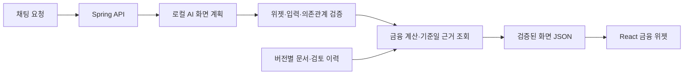

<div align="center">

# 깨비뚝딱 ✨

### 말로 요청하면, 필요한 금융 화면이 뚝딱

채팅의 의도를 금융 위젯으로 바꾸고, 계산·근거·화면 상태를 서버에서 검증하는 백엔드

[](https://spring.io/projects/spring-boot)
[](https://openjdk.org/)
[](https://www.hankyung.com/article/202609032008P)
[](https://kkbb-ddookddak.netlify.app)

</div>

<p align="center">
  <a href="#개요">서비스 소개</a> ·
  <a href="#서비스가-동작하는-흐름">동작 흐름</a> ·
  <a href="#실행-방법">실행 방법</a> ·
  <a href="#ai-연구와-검증-기록">AI 검증 기록</a> ·
  <a href="#api">API</a>
</p>

## 한눈에 보기

| 사용자가 하는 일 | 서버가 책임지는 일 |
| --- | --- |
| 채팅으로 상황과 필요한 기능 설명 | 허용된 금융 위젯의 계획·입력·의존관계 검증 |
| 계산 입력 변경·화면 수정 | 계산 도구 실행, 기준일별 근거 재조회, 화면 리비전 충돌 검사 |
| 금융 안내와 기술 문헌 탐색 | 출처·원문 위치·문서 버전 확인, 부족한 근거 표시 |
| 내부 지식 검토·갱신 | 중복 작업 방지, 중단 후 복구, 승인·반려·릴리스 이력 관리 |

> **구현 범위 안내** · 수상 당시 서비스와 이후 개인 확장 실험을 구분합니다. 공개 데모는 v1이며, 아래 로컬 v2·문헌 탐색·무료 모델 실험은 별도의 개발 환경에서 검증했습니다.

## 서비스가 동작하는 흐름



모델은 화면 계획과 검색 질의를 제안합니다. 계산과 근거 버전, 실제 화면 상태 변경은 서버가 처리합니다.

## AI 연구와 검증 기록

| 자료 | 확인할 내용 |
| --- | --- |
| [최신 병목 분석·플랫폼 개선](docs/문헌검색_병목분석_플랫폼개선.md) | 첫 HTTP 요청 6.94초, 내부 24문항 22개 일치, 검증 조건과 남은 누락 |
| [개발 현황과 다음 작업](docs/개발현황과_다음작업.md) | 완료한 기능·한계·제출 전 우선순위 |
| [MCP·Skill·배치 실행](docs/MCP_Skill_수집파이프라인_실행.md) | 도구 6개, 인용 재검증, 원자적 배치 수집과 DB 조회 |
| [무료 모델 비교와 면접 정리](docs/무료모델_개발결과_면접정리.md) | 실제 측정값, 실패 사례, 3번·9번 직무 연결 |
| [지식 큐레이션 운영](docs/지식큐레이션_운영과_면접.md) | 작업 임대, 장애 복구, 검토 리비전과 승인 버전 검색 |
| [백엔드 면접 질문과 답변](docs/백엔드_면접_질문과답변.md) | 동시성·캐시·근거 버전·모델 선택의 설계 이유 |
| [모델 준비와 비교 실행](docs/모델비교_검색최적화.md) | 무료 로컬 모델 준비, 실행 설정과 재현 명령 |

공식 초록 **30편**과 금융 안내 **26개**를 버전별로 관리합니다. 인용 위치 검증과 의미 정확도를 구분하고, 중단한 실험과 긴 지연도 결과에 남깁니다. 실제 검토 카드는 승인 대기 상태입니다.

새 문헌 경로는 원문 다국어 검색 후 불확실한 후보만 최대 한 번 생성 모델에 검증을 요청합니다. 서버를 다시 띄운 같은 h4 문항의 첫 HTTP 요청은 **6.94초**였고, 기존 기록은 283.76초였습니다. 반복 요청의 캐시 값과 분리해 측정했으며 운영 SLA로 해석하지 않습니다. 같은 내부 24문항의 문헌 ID 집합 일치는 **17 → 22개**로 늘었습니다. 추가 guard 12개와 합성 문서 5천 건의 수집·조회도 별도 검증했습니다.

<details>
<summary><strong>이전 확장 기록 펼치기</strong></summary>

### 금융 화면 구성 v2 확장 (2026-11-03)

**2026-11-04 후속 개발:** [문서 근거·검색 에이전트·로컬 서빙 개발 보고서](docs/ETRI_3_9_개발보고서.md). 공식 근거를 화면에 바인딩하고, 제한적 재검색·작업 상태 저장·문서 버전 복원·실제 모델 비교·서빙 측정을 추가했습니다. 공개 배포와 별도의 로컬 개발입니다.

**현재 확장:** [무료 모델 비교·개발 결과·면접 설명](docs/무료모델_개발결과_면접정리.md), [지식 큐레이션 운영](docs/지식큐레이션_운영과_면접.md). 공식 초록 30편과 금융 안내 26개로 확장하고, 복구 가능한 검토 작업·승인 버전 검색·무료 모델 비교·시스템 KV 캐시를 추가했습니다. 모델의 의미 오류와 초기 호출 지연도 실험 결과에 남깁니다.

면접 준비: [백엔드 질문과 답변](docs/백엔드_면접_질문과답변.md)에서 작업 복구, 동시성, 근거 버전, 모델 선택과 검증 범위를 설명합니다.

**초기 고도화 기록:** [문헌 탐색·AI 자동화·추론 캐시 및 면접 설명](docs/문헌탐색_자동화_면접정리.md). 논문 초록 6편과 금융 안내 26개를 증분 처리한 초기 실험입니다.

**복합 문헌 탐색:** [과제별 근거 연결·누락 표시·지연 분석](docs/복합문헌탐색_근거연결.md). 단일 검색과 요청 분해를 같은 문서 예산으로 비교하고, 문서 버전이 바뀐 인용을 차단합니다.

기존 서비스의 핵심인 **금융 화면 구성**을 확장합니다. 로컬 생성 모델이 서로 다른 금융 위젯을 조합하고, 서버가 의존관계·데이터 binding·위젯 예산·후속 수정·revision 충돌을 검증합니다. Spring의 `/api/canvas/v2`에서 호출하며 `/canvas/preview`에서 같은 JSON을 렌더링합니다.

- [기존 React 프론트 연동·AI 맥락·작업 자동화](FRONTEND_INTEGRATION.md)
- [서비스 중심 설계·실행·현재 한계](GENERATIVE_UI_README.md)
- [화면 구성 실제 모델 회귀 결과](reports/canvas-local-v3.json)
- 문서 검색·생성 모델·임베딩 학습은 위젯의 보조 실험입니다: [RAG](RAG_README.md), [모델 실험](RESEARCH_README.md).

아래 기존 API·9개 위젯 설명은 v1 기준입니다. v2는 기존 React 프론트의 로컬 체크아웃에 연결했습니다. 공개 배포 사이트는 아직 v1입니다.

</details>

## 🏆 제8회 Future Finance AI Challenge 대상

> **풀스택 선우**팀의 **깨비뚝딱**이 대상인 **금융감독원상**을 수상했습니다.

- 본선: 2026년 9월 2일, 이화여자대학교 이삼봉홀
- 경쟁: 전국 약 300개 참가팀 중 본선 10팀 진출
- 팀: 장선우(기획·디자인), 최선우(기획·프론트엔드), 박선우(기획·백엔드)
- 수상 기사: [한국경제](https://www.hankyung.com/article/202609032008P) · [더퍼스트미디어](https://www.thefirstmedia.net/news/articleView.html?idxno=207727) · [스마트투데이](https://www.smarttoday.co.kr/ko-kr/articles/111151)

<p align="center">
  
</p>

## 개요

깨비뚝딱 백엔드는 사용자의 자연어 금융 요청을 분석해 React 프론트엔드가 렌더링할 수 있는 구조화된 위젯 JSON을 반환합니다.

```text
사용자 자연어
  → POST /api/canvas
  → GPT-4o-mini Function Calling
  → 승인 위젯 선택 및 파라미터 추출
  → 서버 데이터 빌드·환율 조회
  → CanvasResponse JSON
```

AI는 필요한 금융 기능을 선택하고, 정확한 환율과 계산 값은 서버가 담당합니다. 생성 가능한 범위는 9개 위젯 enum으로 제한되어 있습니다.

## 주요 기능

- `gpt-4o-mini` Function Calling 기반 복합 의도 분석
- 최대 3개 금융 위젯 선택 및 조합
- 여행지, ISO 4217 통화, 요청 금액, 여행 기간, 모임명 추출
- `open.er-api.com` 기반 실시간 환율 조회
- 환율 데이터 6시간 인메모리 캐시
- OpenAI 또는 환율 API 장애 시 안전한 폴백
- 로컬 Vite 및 Netlify 배포 주소 CORS 허용

## API

### `POST /api/canvas`

요청:

```json
{
  "message": "상하이로 3박 4일 여행 가는데 환전과 QR 결제, 보험을 준비해줘"
}
```

응답:

```json
{
  "greeting": "상하이 여행이라니, 깨비와 함께 즐거운 여행을 준비해봐요!",
  "widgets": [
    {
      "type": "travel_card_charge_widget",
      "currency": "CNY",
      "supported": true,
      "exchangeRate": 190.0
    },
    {
      "type": "overseas_qr_payment_widget"
    },
    {
      "type": "travel_insurance_widget"
    }
  ]
}
```

> `exchangeRate` 값은 예시입니다. 실제 응답에서는 외부 환율 API 조회 결과가 사용됩니다.

## 지원 시나리오와 위젯

| 시나리오 | 위젯 |
| --- | --- |
| 해외여행 준비 | `travel_card_charge_widget`, `overseas_qr_payment_widget`, `travel_insurance_widget` |
| 동아리 회비 관리 | `group_account_status`, `expense_report_widget`, `group_card_safety_widget` |
| 지갑 분실 긴급 대응 | `card_freeze_all`, `atm_smart_withdrawal`, `id_reissue_status_widget` |

## 핵심 설계

### 1. LLM과 금융 계산 분리

`OpenAiApiService`는 사용자의 의도와 통화 코드를 추론하지만 환율 숫자를 생성하지 않습니다. `ExchangeRateService`가 외부 API에서 실제 값을 조회하고 `WidgetDataService`가 최종 위젯 데이터를 계산합니다.

### 2. 승인된 위젯만 생성

Function Calling의 `enum`으로 허용 위젯을 제한합니다. 프론트엔드에서 구현되지 않은 임의의 컴포넌트나 코드를 실행하지 않습니다.

### 3. 장애 폴백

빈 메시지는 LLM을 호출하지 않습니다. OpenAI 네트워크 오류, 인증 오류, 사용량 제한 또는 응답 파싱 실패가 발생하면 빈 위젯 목록을 반환합니다. 환율 API 장애 시 기존 캐시를 유지하며, 캐시도 없으면 지원 불가 상태를 반환합니다.

## 실행 방법

### 요구사항

- Java 17+
- OpenAI API Key

### macOS / Linux

```bash
export OPENAI_API_KEY="your-openai-api-key"
./mvnw spring-boot:run
```

### Windows PowerShell

```powershell
$env:OPENAI_API_KEY="your-openai-api-key"
./mvnw.cmd spring-boot:run
```

서버는 기본적으로 `http://localhost:8080`에서 실행됩니다.

## 환경 변수

| 이름 | 필수 | 설명 |
| --- | --- | --- |
| `OPENAI_API_KEY` | Yes | OpenAI Chat Completions API 인증 키 |


## 테스트

```bash
./mvnw test
```

API 직접 호출:

```bash
curl -X POST http://localhost:8080/api/canvas \
  -H "Content-Type: application/json" \
  -d '{"message":"지갑을 잃어버렸어. 긴급 조치 화면을 만들어줘"}'
```

## 프로젝트 구조

```text
src/main/java/com/example/kb_ai_backend
├── config
│   └── CorsConfig.java
├── controller
│   └── CanvasController.java
└── service
    ├── OpenAiApiService.java
    ├── WidgetDataService.java
    └── ExchangeRateService.java
```

## 향후 확장

- KB 계좌·카드 API 어댑터
- OAuth 및 본인인증
- 정부24·경찰청 공공 API
- 결제·ATM·보험 API
- 감사 로그, 개인정보 암호화, 운영 모니터링

> 핵심 생성 기술은 이미 구현되어 있으며, 이후 확장은 인증·보안·외부 금융 API를 단계적으로 연결하는 엔지니어링 과제입니다.
