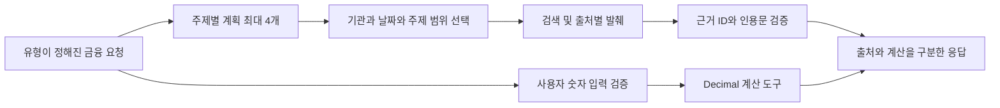

# 깨비뚝딱: 금융 근거검색·시점 제어·계산 도구 개발 정리

**2026-11-03 방향 정정:** 이 문서는 이전 보조 RAG 실험 기록입니다. 현재 제품 개발 중심과 구현은 [Generative UI v2](../GENERATIVE_UI_README.md)를 참고하세요.

작성일: 2026-11-02. 제출 목표: 2026-11-08. 로컬 구현 및 검증 결과를 기록한 문서입니다.

## 1. 이번 확장의 중심

기존 수상작의 자연어 기반 금융 화면 구성 경험에, **금융정보의 출처·기준일·계산 결과를 서버에서 구분하고 검증하는 백엔드**를 추가했습니다. 여행·모임·분실의 세 가지 시나리오에 묶이지 않고 예금보호, 예금담보대출, 예금 중도해지 비용 비교를 다룹니다.

수상자료에 제시된 시스템 설계와 실제 저장소 구현은 구분해야 합니다. 원래 PDF의 멀티턴·어댑터·운영 API·분산 캐시 설계가 이번에 모두 구현되었다고 설명하면 안 됩니다. 이번 구현은 별도 Python 서비스이며 기존 Java 서버와 아직 HTTP 연동하지 않았습니다.

## 2. 실제 구현

| 영역 | 구현과 확인 가능한 증거 | 범위 |
| --- | --- | --- |
| 금융 문서 데이터 | 공식 페이지 8개, 사람이 재서술한 26개 청크 | 전체 금융상품 corpus 아님 |
| 검색 비교 | BM25 / 문자 TF-IDF 결합 / 로컬 다국어 신경망 임베딩 / RRF 결합 | 384차원 CPU exact cosine; ANN 미실험 |
| 기관 격리 | 기관 metadata 범위에서 검색 | KB은행·카드·증권, 신한카드, 금융위원회 |
| 시간 조건 | `published_at`, `content_as_of`, `effective_from`, `effective_until` 구분 | 알고 있는 발표일·시행 기간만 필터링 |
| 복수 근거 | 최대 4개의 선택 주제를 각각 조회하고 출처별 claim 반환 | 클라이언트가 주제를 선택하는 고정 의도 레지스트리 |
| 충돌/부족 처리 | 동일 주제에 겹치는 시행 기록이 있으면 충돌, 일부 주제만 있으면 partial | 범용 의미 충돌 탐지 모델 아님 |
| 계산 도구 | 단리·세금 가정 계산, 원리금균등 상환표, 예금 유지/해지의 이자 비교 | 사용자 입력값·명시한 수식과 가정 기준 |
| 출력 검증 | 스키마, 존재하는 근거 ID, 정확한 발췌문, 숫자 일관성 | 임의 생성 문장의 의미적 진실성 증명 아님 |
| 데이터 갱신 | SQLite 원자적 corpus 교체, 중복 ID/허용 출처/기관 호스트/날짜 검증 | 관리자가 검수한 로컬 파일만 ingest |
| 재현 | corpus·평가 데이터·모델 가중치 해시와 실행 결과 보존 | 독립 외부 평가 아님 |
| 기록 | 요청 ID·상태·사유·지연 감사 로그 | 원문 질문·금액·계좌·provider 응답 로그 저장 안 함 |
| LLM 연결부 | Responses API 구조화 출력과 실패 시 발췌형 fallback | mock 계약 테스트만; 실제 유료 API 미호출 |

### API 흐름

`/finance/analyze`는 자율 LLM 에이전트가 아닙니다. 정해진 주제를 선택한 요청을 서버가 단계별로 처리하는 제한된 워크플로입니다. 자유로운 질문을 읽고 주제를 자동 선택하는 기능은 아직 연결하지 않았습니다.

### 날짜를 네 가지로 구분한 이유

- 확인일: 개발자가 페이지를 확인한 날짜. 정책 시행일이 아닙니다.
- 발표일: 문서가 공개된 날짜. 그 이전 시점의 검색에 문서가 유입되지 않게 합니다.
- 내용 기준일: 기사 내용의 기준 시점. 발표일과 다를 수 있습니다.
- 시행 기간: 정책이 적용되는 것으로 출처에서 확인한 기간. 구간 양 끝을 포함합니다.

금융위원회의 예금보호한도 발표를 사용해 2025-08-31에는 종전 기록, 2025-09-01에는 시행 후 기록이 선택되는지 확인했습니다. 알려진 기간보다 과거인 2025-07-21은 근거 없음으로 처리합니다. KB의 2026-06-22 기사에 적힌 내용 기준일은 2026-06-17이지만, 6월 20일 질문에는 아직 발표되지 않은 기사를 사용하지 않습니다.

끝 날짜가 없는 기록은 이후 정책 변경을 자동 확인했다는 뜻이 아닙니다. KB 기사들은 작성 시점의 설명이며 현재 상품 조건은 다시 확인해야 한다는 표시를 응답에 포함합니다. 실제 금리·개별 상품 보호 여부·대출 승인 여부는 추정하지 않습니다.

### 수치 계산을 분리한 이유

LLM이 이자나 상환 잔액을 직접 생성하면 근거 문서가 있어도 산술 오류가 날 수 있습니다. 계산에는 `Decimal`을 사용하고 화폐 단위·수식·반올림·가정을 함께 반환합니다. 모든 금리와 세율은 사용자 입력이며 문서에서 현재 적용 금리를 임의로 가져오지 않습니다.

- 단리: 원금 × 연이율 ÷ 100 × 일수 ÷ 365 또는 366. 세전 이자와 세금을 각각 원 단위 반올림합니다.
- 월 원리금균등: 고정금리 월 이율 기준. 0% 금리를 별도로 처리하고 마지막 회차에 반올림 잔액을 정산합니다.
- 유지/해지 비교: 세후 만기 이자 − 대출 이자 − 추가 비용 − 세후 중도해지 이자. 이자 차이만 비교하며 재투자·할인율·다른 시점의 현금흐름을 반영한 종합 자산 비교는 아닙니다.

예시 입력에서 만기 이자 1,000,000원, 해지 이자 300,000원, 대출 10,000,000원, 연 3.65%, 100일, 추가 비용 10,000원을 주면 이자 차이는 590,000원입니다. 가상의 사용자 입력 예시이며 KB 상품 금리가 아닙니다.

## 3. 실제 결과

### 기존 안내 질문: corpus 확대 후 회귀 실험

[결과 표](../reports/test-local-expanded-v1.md) / [사례별 JSON](../reports/test-local-expanded-v1.json)

동일 corpus를 보고 사람이 만든 test 30개 중 답변 가능한 질문은 19개입니다. 개발용 질문 12개와는 구분하지만 독립 블라인드 벤치마크가 아닙니다.

| 검색 방식 | 원시 검색 Hit@1 | Hit@3 | MRR@3 | 상태+근거 일치 |
| --- | ---: | ---: | ---: | ---: |
| BM25 | 13/19 | 17/19 | 0.772 | 29/30 |
| 문자 기반 결합 | 18/19 | 19/19 | 0.974 | 30/30 |
| 로컬 신경망 임베딩 | 13/19 | 18/19 | 0.816 | 30/30 |
| 문자 검색+임베딩 RRF | 15/19 | 19/19 | 0.886 | 30/30 |

로컬 임베딩이 문자 기반 검색을 이기지 못했습니다. 짧고 정형적인 한국어 절차 안내, 작은 corpus, 키워드 확장, 모델 선택의 영향을 함께 받으므로 일반적인 우열로 결론내릴 수 없습니다. 현재 기본값은 저비용 문자 기반 결합 검색을 유지했습니다. 임베딩을 붙였다는 이유만으로 성능 개선을 주장하지 않습니다.

상태+근거 일치에는 규칙 기반 주제 필터가 개입합니다. 원시 검색 순위와 답변 결과를 따로 기록한 이유입니다. 30/30은 LLM 환각률 0%나 금융 답변 정확도 100%를 의미하지 않습니다.

### 금융 시행일 필터 제거 실험

[결과 표](../reports/finance-temporal-v1.md) / [모든 사례와 워크플로 출력](../reports/finance-temporal-v1.json)

같은 기관·주제·검색 규칙에서 날짜 필터만 제거한 조건과 비교했습니다.

| 검색 방식 | 날짜 필터 없음 | 날짜 필터 있음 |
| --- | ---: | ---: |
| BM25 | 10/28 | 22/28 |
| 문자 기반 결합 | 12/28 | 28/28 |
| 로컬 신경망 임베딩 | 12/28 | 28/28 |
| RRF | 12/28 | 28/28 |

28개는 **7개 날짜 × 4개 표현**의 조합이라 서로 상관된 사례입니다. 제도 1종·출처 2개의 좁은 탐색 실험이며 28개 독립 금융업무를 맞힌 결과가 아닙니다. BM25에는 필터 후에도 단어가 일치하지 않아 검색에 실패한 사례가 남아 있습니다. 필터는 검색 언어 이해 자체를 해결하지 않습니다.

### 테스트와 실행 검증

- `python -m pytest tests_rag -q`: **70 passed**. 기존 테스트 40개와 금융·날짜·산술 관련 추가 30개입니다.
- 단리 계산은 고정 난수 seed의 100개 입력을 독립적인 정수/유리수 계산 oracle과 비교했습니다. pytest 수와 100개 입력 수를 합쳐 테스트 개수로 부르지 않습니다.
- 상환표는 0% 금리, 600회차, 작은 원금 등에서 원금 합·납입액 합·마지막 잔액 0을 확인했습니다.
- 날짜 경계는 네 검색 방식에서 검사했습니다. 테스트의 모의 임베더와 보고서의 실제 CPU ONNX 실행을 구분합니다.
- [실제 HTTP 실행 기록](../reports/live-finance-smoke.json): 확장 API 요청 8개, 금리 등 숫자 누락 시 HTTP 422, OpenAPI 응답 스키마를 확인했습니다.
- Starlette TestClient의 httpx 사용 방식에 관한 deprecation 경고 1개가 있습니다. 테스트 실패는 없습니다.

## 4. 지원서와 포트폴리오에 쓰는 방법

### 사용할 수 있는 설명 초안

> 금융 서비스 프로토타입의 백엔드를 확장해 공식 금융 안내의 기관·기준일 기반 검색과 근거 검증 API를 구현했습니다. BM25, 문자 기반 검색, 로컬 다국어 임베딩과 순위 결합을 비교하고, 금융 정책의 발표일과 시행 기간을 검색 범위에 반영했습니다. 이자 및 대출 상환 계산은 LLM 응답과 분리해 Decimal 도구로 처리했으며, 작은 수작업 평가셋에서 성능과 실패 사례를 재현 가능한 보고서로 기록했습니다.

코드를 읽고 실험을 재실행한 뒤, 구현 범위와 확인한 결과를 기준으로 설명합니다.

### 강조점을 달리할 수 있는 부분

| 지원 방향 | 강조할 내용 | 현재 부족한 증거 |
| --- | --- | --- |
| 금융권 IT·백엔드 | 금액 정합성, 입력 검증, 기준일, 출처, 감사 로그, 실패 응답 | 실제 계좌 권한·승인·거래·외부 금융 API 운영 |
| AI 서비스 백엔드 | 모델 준비, API 계약, 문서 버전, 임베딩 캐시, 생성 실패 처리 | 기존 Java 서버 연동, 인증, 부하·장애 운영 |
| 문서 검색·지식 시스템 | 검색 방식 비교, metadata 필터, 복수 근거, 데이터 해시 | 더 큰 corpus, 독립 라벨, 다양한 장문 문서 |
| LLM 평가·연구 보조 | 기준선, 제거 실험, 실패 보존, 평가 정의와 한계 | 실제 생성 모델 답변 평가, 사람 검수, 의미적 근거 평가 |

이 실험은 지식그래프를 구축한 GraphRAG, 모델 학습/미세조정, 자율 멀티 에이전트, 실제 은행 서비스 연동 경험으로 소개하면 안 됩니다. 연구실 경험이 없어도 실험 질문과 평가 한계를 설명하는 자료로 쓸 수 있지만, 특정 분야 합격 가능성을 보장하지는 않습니다.

## 5. 11월 8일 제출까지 우선순위

기능 수를 늘리는 것보다 다음 증거를 만드는 순서가 효율적입니다. 아래 항목은 **미완료 작업**입니다.

1. 11/03: 선우가 코드 흐름을 직접 실행하고 날짜 오류·서로 다른 기관·금리 누락 사례를 설명하는 연습. 실제로 겨냥할 모집 분야와 자기소개서 표현 확정.
2. 11/04: 새로운 금융 주제/문서 유형을 검수해 추가하고, 개발 중 보지 않은 질문을 따로 작성해 평가. 표본을 늘릴 때 비슷한 표현만 복제하지 않기.
3. 11/05: 기존 Java 서버에서 검색 서비스를 호출하는 계약 구현과 장애 응답 검증. 인증·권한이 없는 연구 API의 범위를 명확히 하기.
4. 11/06: 사용 가능한 무료 로컬 생성 모델 또는 추후 허용한 API로 생성 답변을 평가. 비용·환경이 안 되면 추출형 실험임을 유지하고 생성 평가를 꾸며내지 않기.
5. 11/07: 포트폴리오에 문제·설계·실험·실패·개선의 4쪽 내외 추가. 실제 실행 영상과 재현 명령 정리.
6. 11/08: 블라인드 요건·출처·수치·직접 기여 범위 확인 후 제출.

## 6. 출처와 파일

- [금융위원회 2025-07-22 발표](https://www.fsc.go.kr/no010101/84974): 종전 한도 및 시행일.
- [금융위원회 2025-09-01 시행 발표](https://www.fsc.go.kr/no010101/85200): 시행 후 원금·이자 포함 한도.
- [KB 예금담보대출 설명](https://kbthink.com/loan-guide/deposit-mortgage.html?gf=false): 2026-06-17 내용 기준일, 2026-06-22 발표.
- [KB 긴급자금 비교 설명](https://kbthink.com/loan/find/emergency-funds.html): 2026-07-20 내용 기준일, 2026-07-27 발표.
- 기존 카드 이용안내 4개 출처와 실행법: [RAG_README](../RAG_README.md).
- 구현: `rag_backend/finance.py`, `pipeline.py`, `retrieval.py`, `dense.py`, `generation.py`, `store.py`.
- 데이터와 시행 구간: `data/financial_guides.json`.
- 모든 보고서는 실행 당시 corpus 스냅샷을 함께 보존합니다. 이전 19개 청크 실험과 현재 26개 청크 실험을 혼동하지 마세요.
